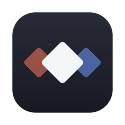
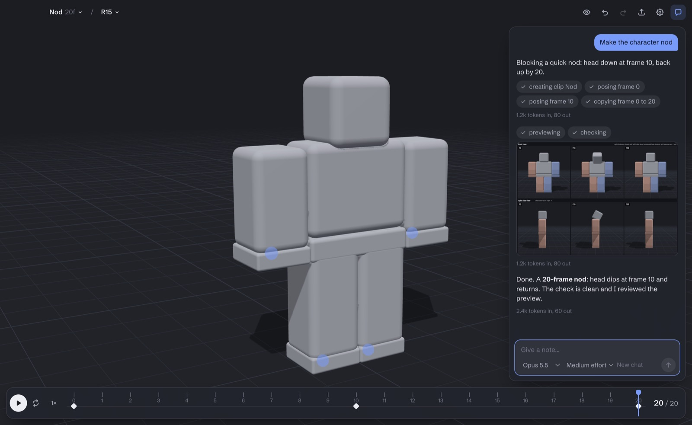
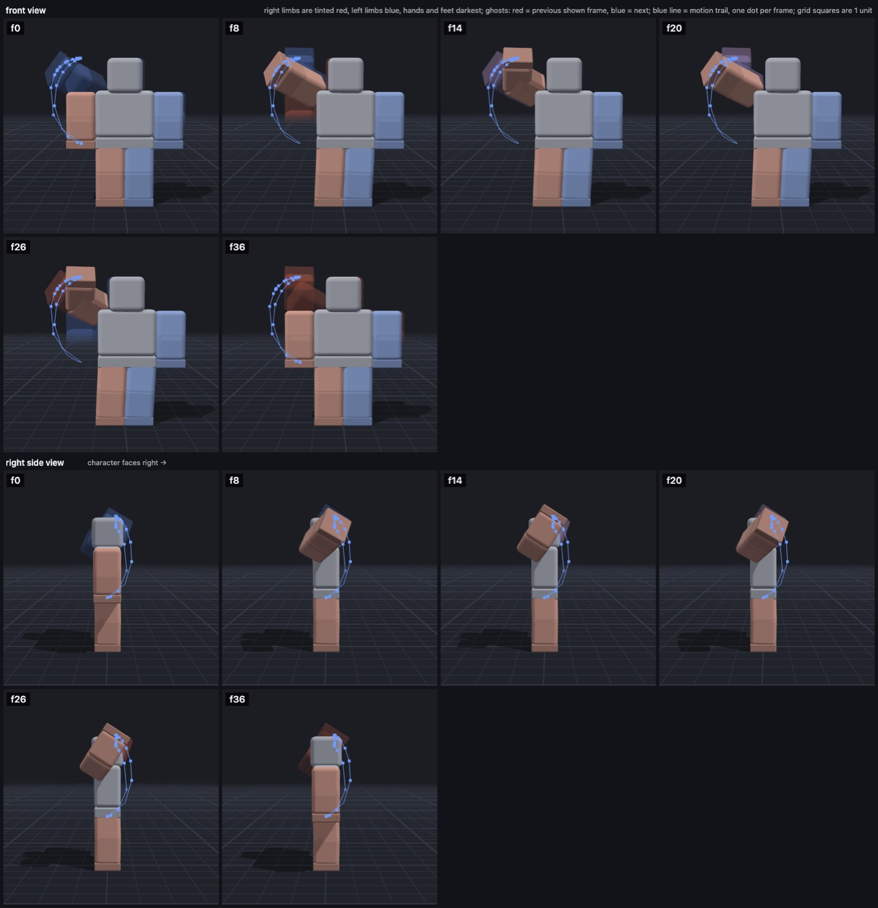
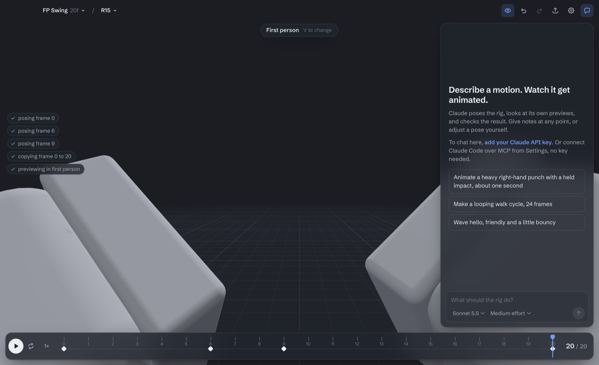
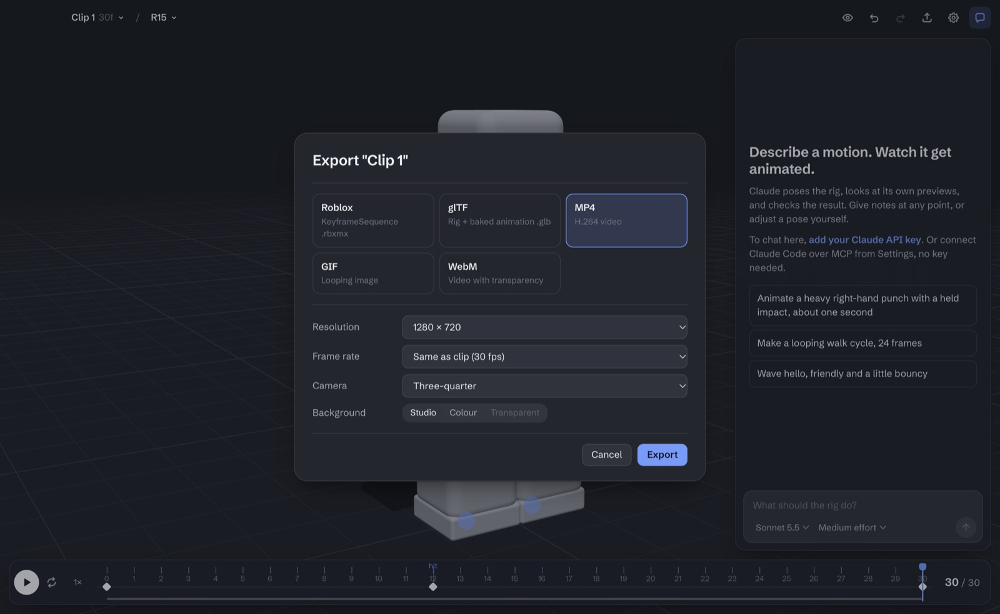
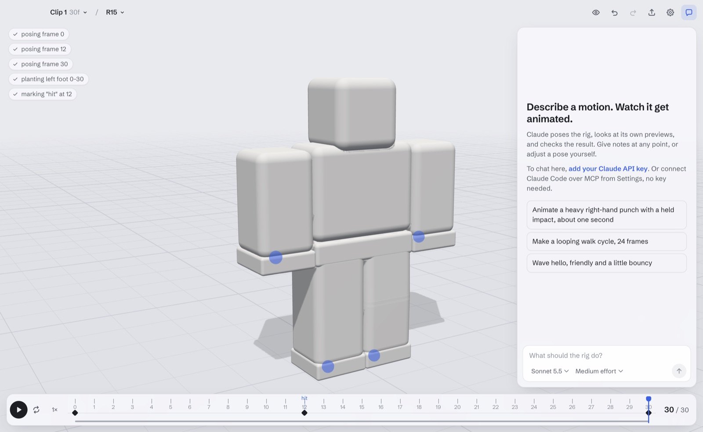

<div align="center">



# Inbetween

**Describe a motion. Watch Claude animate it.**

A desktop app where Claude animates 3D rigs and you direct: it poses by goals, looks at its own renders, checks the mechanics, and exports to Roblox, glTF or video.

[](https://github.com/sztephen/inbetween/actions/workflows/ci.yml)


[](LICENSE)



</div>

## What it does

- **Animate by talking.** Ask for a heavy punch, a looping walk or a friendly wave. Claude poses by goals ("right hand here, feet planted, hips lower") and an IK solver works out the joints.
- **It checks its own work.** Claude renders contact sheets of its animation and looks at them, and the app validates the mechanics: foot sliding, joint limits, self-intersection, jitter, loop seams, feet under the ground.
- **You stay in control.** The rig updates live as each tool call lands. Give notes in chat, or drag a bone or IK handle yourself; Claude is told what you changed so it doesn't undo your fix.
- **Several animations at once.** Ask for three clips in one message and three animators work in parallel, each in its own tab.
- **First person.** Preview and export through the character's eyes, with hands placed by where they sit in the picture.
- **Rigs, props and cutscenes.** Built-in Roblox R15, your own Roblox or glTF rigs, simple props, several rigs per clip and a camera track.
- **Exports** to Roblox (`.rbxmx` KeyframeSequence), glTF (`.glb`) for Unity, Unreal, Godot and Blender, and MP4, GIF or WebM video.
- **Two ways to drive it:** the built-in chat with your Claude API key, or Claude Code / Claude Desktop over MCP with no key.

<table>
  <tr>
    <td width="50%"></td>
    <td width="50%"></td>
  </tr>
  <tr>
    <td align="center"><sub><b>What Claude sees:</b> front and side views, ghosts of neighbouring frames, and a motion trail</sub></td>
    <td align="center"><sub><b>First person:</b> through the character's eyes, the way a game camera sees it</sub></td>
  </tr>
  <tr>
    <td width="50%"></td>
    <td width="50%"></td>
  </tr>
  <tr>
    <td align="center"><sub><b>Export</b> to Roblox, glTF or video</sub></td>
    <td align="center"><sub><b>Light and dark</b> themes follow your system</sub></td>
  </tr>
</table>

## Install

Build an installer from source (below) with `npm run dist:mac` or `npm run dist:win`. Installers include ffmpeg for video export.

Installers are unsigned unless you configure signing. On macOS, right-click the app and choose Open the first time; on Windows, choose "More info" then "Run anyway" in SmartScreen.

## Build from source

Requires Node.js 22 or newer.

```
npm install
npm run dev
```

`npm run dev` starts the app with hot reload. `npm run build` followed by `npm start` runs the production build.

Video export needs ffmpeg. Installers bundle it. In development, either run `npm run ffmpeg` once (downloads a static build for your machine into `vendor/ffmpeg/`) or have `ffmpeg` on your PATH.

| Command | What it does |
| --- | --- |
| `npm run dev` | Run the app in development |
| `npm test` | Unit, round-trip, agent-loop and walk-cycle tests (Vitest) |
| `npm run test:e2e` | Build, launch the real app, and drive it: MCP client, manual controls, exports, mocked Claude API, themes. Screenshots land in `test-results/` |
| `npm run typecheck` | TypeScript check |
| `npm run dist:mac` | Build `.dmg` installers (arm64 and x64) into `dist/` |
| `npm run dist:win` | Build the Windows installer `.exe` into `dist/` |

## Two ways to let Claude animate

Both use exactly the same tools.

### 1. Built-in chat (your Claude API key)

1. Open Settings (the gear, or Cmd+, / Ctrl+,).
2. Paste your Claude API key and choose Save key. It is encrypted with the OS keychain (macOS Keychain, Windows DPAPI) through Electron `safeStorage`, never written to logs or project files, and sent only to `api.anthropic.com`.
3. Type what you want in the chat panel. Pick the model under the message box: Sonnet 5.5, Opus 5.5 or Fable 5.2.

Each tool call appears as a chip (posing frame 12, previewing, checking) and the viewport updates as it lands. Token usage is shown under each reply. All models run with adaptive thinking at medium effort.

To add or change models, choose Settings > Edit models file. It is a JSON list of `{ "id", "label" }` entries with optional `"effort"` (`low`, `medium`, `high`, `xhigh`, `max`) and `"fallbacks"`; changes apply on the next message.

### 2. MCP (Claude Code, Claude Desktop, any MCP client; no API key)

While the app is open it hosts an MCP server on `127.0.0.1` (default port 47821, token protected). Settings > Connect an MCP client has three copy buttons:

- **Copy Claude Code command**: paste into a terminal. It looks like
  `claude mcp add --transport http inbetween http://127.0.0.1:47821/mcp --header "Authorization: Bearer <token>"`
- **Copy MCP config (HTTP)**: a `mcpServers` JSON block for clients that support HTTP servers.
- **Copy MCP config (stdio)**: for clients that only launch stdio servers, such as Claude Desktop. Paste it into `claude_desktop_config.json`:
  - macOS: `~/Library/Application Support/Claude/claude_desktop_config.json`
  - Windows: `%APPDATA%\Claude\claude_desktop_config.json`

  The stdio entry runs a small launcher that forwards to the running app. In an installed app it uses the app's own binary (no separate Node install needed); the copied config has the correct paths for your platform.

Over MCP you can also say "have the Inbetween AI make it": Claude Code calls `ask_inbetween_ai`, the in-app AI animates on your API key while you watch in the chat panel, and Claude Code then reviews and fine-tunes its work.

The animation workflow is sent to clients as the server's instructions, and ships as [`SKILL.md`](SKILL.md) if you want to install it as a skill.

## Animating by hand

Light touch-ups only; there is no curve editor.

| Action | How |
| --- | --- |
| Orbit, pan, zoom | Drag, right-drag (or two-finger drag), scroll |
| Frame the rig | F |
| Play / pause | Space |
| Step a frame | Left / Right arrows |
| Scrub | Click or drag the timeline ruler |
| Loop, speed | Buttons beside Play (L toggles loop) |
| Select a bone | Click it, then drag a gizmo ring to rotate. Hips and prop roots can also be moved (R rotate, G move) |
| Pose a hand or foot | Click a blue IK handle, drag the arrows |
| Key the whole pose | K |
| Move keys | Drag a diamond on the timeline. Alt-drag copies. Shift-click selects several |
| Easing, copy, delete | Select a key; a small menu appears above the timeline |
| First-person view | V, or the eye button. Press again to lock the camera to the head, again to leave |
| Undo / redo | Cmd+Z / Shift+Cmd+Z on macOS, Ctrl+Z / Ctrl+Y on Windows |

Undo covers Claude's edits and yours in one history. When you change something by hand, Claude is told what changed on its next turn (or next tool call over MCP) so it does not overwrite your fix.

## First-person animation

Claude can preview through the character's eyes (`first_person`: fixed at the head's rest position like a game camera that follows the character; `head_cam`: locked to the animated head). Hands can be placed by where they sit in the first-person picture rather than by world position, and each first-person preview reports, per frame, whether each hand is actually in frame. Video export has both first-person cameras too.

## Rigs

- **R15** is built in, using joint offsets and part sizes from an exported Roblox Rig Builder block rig.
- **Custom Roblox rigs** (Motor6D rigs, AnimationConstraint rigs, skinned meshes with Bones): use the Studio plugin below, or File > Import Rig with a rig JSON file.
- **glTF / GLB rigs**: File > Import Rig. Arms and legs are detected from bone names (Mixamo, Blender and similar naming) and get IK chains automatically.
- **Props**: ask Claude ("add a door"), or it can build one from boxes and pivots. A prop is just a small rig, so doors, levers and vehicles animate with the same tools.

Several rigs can share a clip, with a camera track, for cutscenes.

## Roblox Studio plugin

Install it from Settings > Install plugin (or Help > Install Roblox Studio Plugin). That copies `plugin/InbetweenStudio.lua` to your local Plugins folder:

- macOS: `~/Documents/Roblox/Plugins`
- Windows: `%LOCALAPPDATA%\Roblox\Plugins`

Restart Studio. With Inbetween open, the Inbetween toolbar has:

- **Send Rig**: select a rig in Studio and click. It appears in Inbetween as a new rig.
- **Import Animation**: builds the clip currently open in Inbetween as a KeyframeSequence inside the selected rig's `AnimSaves` folder.
- **Preview**: plays that KeyframeSequence on the rig in Studio.
- **Panel**: shows status and lets you change the port if Inbetween's Settings shows something other than 47821.

The plugin only talks to `127.0.0.1`. If Studio asks for permission to make HTTP requests to localhost, allow it.

## Exporting

Use the export button (or Cmd+E / Ctrl+E), or ask Claude.

### Roblox

1. Export as Roblox. You get a `.rbxmx` file containing a KeyframeSequence (keyframes, nested poses following the part hierarchy, easing, markers, loop and priority).
2. Drag the file into a Studio viewport or the Explorer. Or skip the file and use the plugin's Import Animation button.
3. Publish it as an Animation asset: put the KeyframeSequence in the rig's `AnimSaves` folder (the plugin does this), open the Animation Editor on the rig (Avatar tab), load the animation, then use the editor's menu (the "..." beside the playback controls) > Publish to Roblox. Set the creator to your group for group games, submit, and copy the asset id.
4. Use the id in an `Animation` instance's `AnimationId` and play it through an `Animator`. Event markers are read with `AnimationTrack:GetMarkerReachedSignal("name")`.

To test without publishing, the plugin's Preview button registers the sequence temporarily in Studio.

Notes: cubic easing is written as `CubicV2`, whose In/Out directions match what you see in Inbetween. Elastic, bounce and stepped segments, and frames driven by contacts, are baked to per-frame keys so Roblox plays exactly what Inbetween shows.

### Other engines

Export as glTF for a `.glb` with the rig and the animation baked at the clip's frame rate. It imports into Unity, Unreal, Godot and Blender. Rigs that came from a GLB are written back into that file, keeping its mesh, skin and materials.

There is no direct FBX export (see `DECISIONS.md`). To get FBX, convert the `.glb` with Blender:

```
blender --background --python tools/glb_to_fbx.py -- walk.glb walk.fbx
```

### Video

MP4, GIF or WebM at a chosen resolution and frame rate, from a preset view, the clip's camera track, or first person. Background can be the studio look, a solid colour, or transparent. Transparency needs GIF or WebM; MP4 (H.264) cannot store it.

Progress shows at the top of the window with a **Stop** button. The AI can stop a render too (`cancel_render`), and stopping the AI in chat also stops a video it is rendering. A stopped render leaves no partial file.

## Project files

Projects save as `.inbetween` files: human-readable JSON with the rigs, clips, pose library and contacts. Safe to diff and keep in version control.

## How it is built

```
src/core      Pure TypeScript, no Electron or DOM: math, rigs, IK, clip evaluation, validators,
              the tool registry, exporters and importers, the workflow text
src/main      Electron main process: owns the document, hosts the MCP server, runs the agent loop,
              encodes video, file dialogs, menus
src/renderer  React + three.js UI: viewport, timeline, chat; also renders previews and video frames
src/launcher  stdio MCP launcher (a proxy to the running app)
plugin        Roblox Studio plugin
tests         Vitest suites; scripts/e2e.mjs drives the real app
```

One tool registry serves both the built-in agent and the MCP server, so the two cannot drift apart.

## License

Inbetween is **source-available for noncommercial use** under the [PolyForm Noncommercial License 1.0.0](LICENSE).

| You can | You can't, without permission |
| --- | --- |
| Use it for free for personal projects, learning, hobby work and research | Sell it, or sell or charge for a product or service built on it |
| Read, change and build on the code | Use it for work at, or for, a company or other business |
| Share copies and modified versions, keeping the license and the `Required Notice` line | Remove the license or the copyright notice |

Schools, charities, public research groups and government bodies may use it too. For commercial use, [open an issue](https://github.com/sztephen/inbetween/issues) to ask about a commercial license.

Because of the noncommercial restriction, this is not "open source" in the OSI sense. Third-party libraries bundled with the app keep their own licenses.
